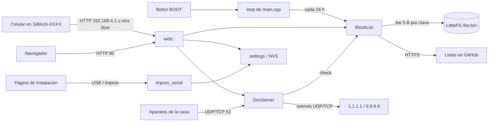
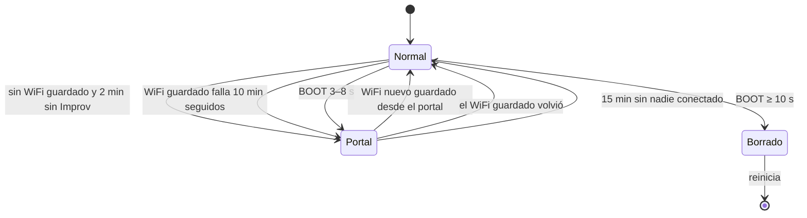
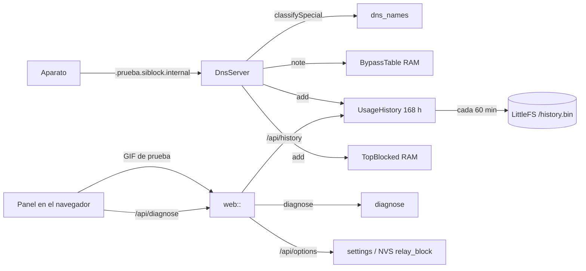
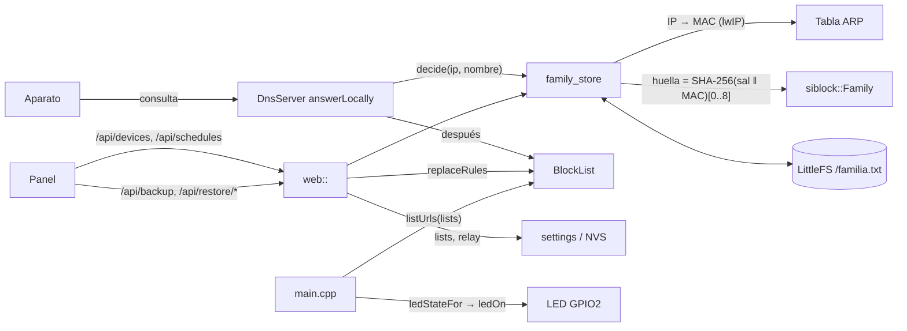

# Arquitectura

## Contexto

SiBlock es un ESP32 que hace de servidor DNS de la casa. El router lo reparte por DHCP y todos los aparatos le
preguntan. Si un dominio está en la lista, contesta `0.0.0.0` / `::`; si no, reenvía la consulta a
un DNS público y devuelve la respuesta.

Objetivo de hardware: el ESP32 más barato que existe, el WROOM-32 clásico. Tiene 2 núcleos a
240 MHz, unos 320 KB de RAM y 4 MB de flash, y **no tiene PSRAM**. Casi todas las decisiones salen
de ese límite.



Lo que se agrega en la fase 1 (configurar sin recompilar) está en
[Fase 1: configuración sin recompilar](#fase-1-configuración-sin-recompilar), y lo de la fase 2
(comprobación, "algo no funciona", gráficas) en [Fase 2: acompañamiento](#fase-2-acompañamiento), y lo
de la fase 3 (reportes, aviso de versión, estadísticas y Contáctanos, con un Worker en internet) en
[Fase 3: la nube, opcional](#fase-3-la-nube-opcional), y lo de la fase 5 (aparatos, horarios,
listas opcionales, LED, ahorro y respaldo) en [Fase 5: uso diario en casa](#fase-5-uso-diario-en-casa).

## Piezas

| Archivo | Responsabilidad |
|---|---|
| `src/main.cpp` | Arranque (versión, NVS, autoprueba de la clave), WiFi sin bloquear, montaje de LittleFS, mDNS. En `loop()`: panel, botón, Improv, política del portal, actualización diaria con reintentos y la línea `STATS` |
| `src/settings.*` | Configuración en la NVS (espacio `siblock`): WiFi, hash de la contraseña del panel, contraseña del AP; semilla opcional desde `secrets.h`; borrado |
| `src/improv_serial.*` | Improv Serial: WiFi y contraseña de respaldo por USB |
| `src/portal.*`, `src/portal_page.h` | Modo de configuración: AP WPA2 `SiBlock-XXXX` en una red que no choca con la de la casa, DNS cautivo y página para elegir red |
| `src/button.*` | Botón BOOT (GPIO0) y LED (GPIO2) |
| `src/dns_server.*` | Recibir consultas, decidir, caché, reenvío, DNS por TCP, anti-rebinding y estadísticas por aparato |
| `src/blocklist.*` | Descargar y armar la lista, buscar, reglas propias, pausa |
| `src/web.cpp`, `src/web_page.h` | Panel y API: sesión, bloqueo por IP, Host, topes del cuerpo |
| `src/family_store.*` *(fase 5)* | Aparatos con nombre, pausas por aparato y horarios en la placa: tabla ARP → huella, `/familia.txt`, decisión para la tarea DNS |
| `src/config.h` | Lo que se ajusta: tope, DNS de arriba, nombre (`siblock`, y `adblock` por compatibilidad), versión (`SIBLOCK_VERSION`), IP fija, anti-rebinding |
| `src/certs.h` | CAs raíz fijas para validar HTTPS de las descargas y *(fase 3)* de `siblock.s-dev.win` |
| `src/cloud.*` *(fase 3)* | Cliente HTTPS hacia el Worker (`postJson`, `fetchLatestVersion`) y el estado de la nube en RAM |
| `lib/adblock_core/` | Lógica pura (parser DNS, hash, índice, reglas, caché, JSON), sin Arduino |
| `lib/siblock_core/` | Lógica pura de SiBlock, sin Arduino: SHA-256 y PBKDF2 (`siblock_crypto`), base64 y validaciones (`siblock_text`), Improv (`improv`), botón, LED, ventana de creación y política del portal (`modes`); *(fase 2)* nombres especiales (`dns_names`), historia de 168 h y top de bloqueados (`usage`), aparatos que se saltan y diagnóstico (`diagnose`); *(fase 5)* aparatos, horarios y grupos (`family`), formato del respaldo (`backup`), catálogo de listas (`lists`), LED de estado (`modes`) y ahorro (`usage`) |
| `lib/WebServer/` | Copia parcheada del `WebServer` de Arduino con topes (ver `CAMBIOS.md`) |
| `sim/` | Capa falsa de Arduino/FreeRTOS para correr `src/` en Linux |
| `site/` | Página de instalación (estática, ESP Web Tools) |
| `.github/` | CI y publicación de versiones (firmware en la Release y página en Cloudflare Pages) |
| `cloud/` *(fase 3)* | Worker `siblock-api` (TypeScript) con D1: reportes, aviso de placa, embudo, Contáctanos, estadísticas y resumen del dueño. No lo publica CI |

## Tareas y concurrencia

| Tarea | Núcleo / prioridad | Pila | Qué hace |
|---|---|---|---|
| `async_udp` (del core) | — | 4 KB | Recibe paquetes. Las consultas de clientes solo se copian a una cola de 16. Las respuestas del DNS de arriba se validan y se entregan aquí mismo |
| `dns` | 1 / 5 | 8 KB | Saca de la cola, decide (lista, caché o reenvío) y contesta. Tiene un **vigilante de 30 s**: si se traba, el ESP32 se reinicia |
| `dns_tcp` | 1 / 4 | 8 KB | Atiende DNS por TCP, una conexión a la vez, con 3 s de plazo |
| `boton` *(fase 5)* | 1 / 1 | 3 KB | Lee BOOT y maneja el LED cada 20 ms; la acción (ventana, modo de configuración o borrado) la guarda en una variable atómica y la atiende `loop()` |
| `loopTask` (Arduino) | 1 / 1 | 8 KB | `web::loop()` (panel y portal), la acción del botón que dejó la tarea `boton`, Improv por serie, política del portal, vigilancia del WiFi, autoprueba del puerto 53, actualización de la lista y `STATS` cada 5 s |

**Límite conocido de `loopTask`:** todo lo de esa fila corre en orden. Mientras se baja la lista
(hasta 10 s esperando la hora y luego la descarga, que puede tardar minutos) y mientras el portal
escanea redes WiFi (unos segundos), el panel, el portal e Improv no responden. El DNS sí, porque
va en sus propias tareas. El botón BOOT se sigue leyendo (tarea `boton`) y el LED sigue avisando
cuándo soltar; la acción queda guardada y se hace cuando el loop vuelve. El escaneo del portal se hace como mucho una vez cada 10 s (entre medias se devuelve el
último resultado). Pasar la descarga a una tarea propia queda pendiente: pide cuidar la RAM y
los datos que hoy comparte con el loop.

Datos compartidos y cómo se protegen:

- `BlockList::mutex_` protege el índice, el archivo abierto, las reglas y `lastError_`. La tarea
  DNS lo pide con un plazo de 50 ms y, si no lo consigue, **deja pasar** la consulta.
- La pausa usa la sección crítica `gPauseMux`.
- Los contadores (`DnsStats`) son `uint32_t` que escribe una sola tarea. Leer un valor un poco
  atrasado no importa.
- Las tablas de consultas en vuelo, de aparatos y de consultas recientes tienen su propio candado
  en `dns_server.cpp`.

## Vigilancia en la placa

| Qué falla | Cómo se nota | Qué hace |
|---|---|---|
| La tarea `dns` se traba | Vigilante de tareas (30 s) | Reinicia |
| El WiFi se cae y no vuelve solo | `WiFi.status()` | A los 2 min reconecta a mano. Ya **no reinicia**: a los 10 min seguidos abre el modo de configuración y sigue probando el WiFi guardado cada 2 min |
| El puerto 53 deja de recibir (AsyncUDP muerto) | Cada 5 min el ESP32 se manda un paquete a sí mismo (`DnsServer::sendProbe`) | Tras 3 fallos seguidos reinicia, pero solo si la prueba funcionó alguna vez: si la placa no entrega paquetes a su propia IP, nunca reinicia por error |
| La RAM está fragmentada antes de bajar la lista | `ESP.getMaxAllocHeap() < 32 KB` | No descarga; a la tercera vez reinicia (la lista queda guardada) |
| No hay hora para validar los certificados | `time()` antes de 2023 | Espera hasta 10 s a NTP (`pool.ntp.org`, `time.cloudflare.com`) y sigue igual |

Mientras se actualiza la lista (1 a 2 minutos en la placa), `loopTask` está ocupada y **el panel
no responde**. El DNS sí sigue contestando con la lista vieja. Es a propósito: el panel es lo
menos importante.

## Memoria

| Uso | Tamaño | Cuándo |
|---|---|---|
| Fijo (firmware + estáticos) | ~64 KB (19,6 %) | siempre |
| *(Fase 5)* Pila de la tarea `boton` | 3 KB | siempre |
| *(Fase 2)* Historia de 168 h | 1,3 KB (168 × 8 B) | siempre |
| *(Fase 2)* Top de bloqueados | ~2,2 KB (32 × 68 B) | siempre |
| *(Fase 2)* Aparatos que se saltan | ~200 B (16 casillas) | siempre |
| *(Fase 5)* Aparatos con nombre y horarios (`siblock::Family`) | ~1,5 KB (32 × 42 B + 8 × 12 B + sal; estimado, falta medir con `pio run`) | siempre |
| *(Fase 5)* Caché IP → huella y pausas por aparato | ~0,5 KB (16 + 32 casillas) | siempre |
| *(Fase 5)* Lectura del respaldo | hasta unos 24 KB (reglas y familia en un `Backup` temporal; estimado) | solo al revisar o aplicar un respaldo (`apply` pide ≥ 40 KB seguidos) |
| Índice de la lista | 16 KB (4097 × 4 B) | siempre |
| Caché DNS | hasta ~32 KB (64 × 512 B) | se vacía antes de actualizar y no se llena mientras se descarga ni con menos de 24 KB de RAM seguida |
| Cola de consultas | 8 KB (16 × 512 B) | siempre |
| TLS de una descarga | ~45 KB | durante la descarga |
| Armado de la lista | ~20 KB de búferes + ~40 KB para ordenar una cubeta | durante la actualización |

Flash (`partitions.csv`, no se cambia): NVS de 20 KB en 0x9000 (WiFi y contraseñas), 1,5 MB de
programa **sin OTA** en 0x10000 y 2,44 MB de LittleFS. La lista usa
~800 KB y, al actualizar, la vieja y la nueva conviven. Por eso existe `MAX_DOMAINS` (180 k): así
no se acaba la flash.

## Decisiones y por qué

| Decisión | Alternativa descartada | Por qué |
|---|---|---|
| Hash de 40 bits en flash, búsqueda binaria por cubetas | Guardar los nombres / árbol en RAM | 160 k dominios no caben en 320 KB. Con 5 B por dominio caben ~800 KB en flash, y la probabilidad de un falso positivo es ~1 en 5 millones |
| Un solo archivo `[claves][índice]` y `rename` | Dos archivos | El `rename` es atómico: un corte de luz deja la lista vieja o la nueva, nunca una mezcla |
| Ordenar en 64 cubetas temporales | Ordenar todo en RAM | Cada cubeta cabe en ~40 KB de RAM |
| AsyncUDP + cola + tarea propia | Atender en el callback | El callback corre con 4 KB de pila. Leer la flash y el TLS necesitan más |
| HTTP sin TLS en el panel | HTTPS | TLS gasta ~45 KB por conexión sin PSRAM. Se acepta el riesgo (ver [seguridad.md](seguridad.md)) |
| Sin OTA | Dos particiones de programa | Con OTA la lista no cabría |
| Copia parcheada de `WebServer` | AsyncWebServer | Menos RAM y menos cambios; los topes se agregaron en ~60 líneas |
| WiFi y contraseñas en la NVS | `secrets.h` compilado | Una persona sin conocimientos no puede recompilar; el firmware publicado es el mismo para todos |
| Contraseña del panel como PBKDF2 con sal e iteraciones guardadas | Texto o SHA-256 simple | Leer la NVS no da la contraseña; las iteraciones se pueden subir sin romper hashes viejos |
| Publicar tres partes (0x1000, 0x8000, 0x10000) en el `manifest.json` | Un solo `.bin` desde 0x0 | El `.bin` unido rellena la NVS y borraría el WiFi en cada actualización |
| Lógica nueva en `lib/siblock_core` | Dentro de `src/` | Se prueba en la PC con `test_siblock`, sin placa |
| *(Fase 2)* 168 horas UTC en la placa; el navegador arma 24 h y 7 días | 24 + 7 pares fijos | Cada persona ve su hora local y la placa no necesita zona horaria |
| *(Fase 2)* Top 10 con Space-Saving en 32 casillas | Contar todos los dominios | Memoria fija (~2,2 KB) aunque se visiten miles de dominios |
| *(Fase 2)* Detectar DNS cifrado sin bloquearlo | Bloquear `dns.google` y compañía | Bloquearlo rompe aparatos que lo eligieron a mano; cortarlo es el "modo estricto" de más adelante |
| *(Fase 2)* `/api/diagnose` pública | Pedir la contraseña | Cualquiera de la casa puede pedir ayuda; solo habla de su propio aparato |
| *(Fase 3)* Todo lo que sale a internet, apagado de fábrica | Encendido con aviso | SiBlock ve todo lo que visita la casa: hablar con internet tiene que ser decisión del dueño |
| *(Fase 3)* Worker en la misma dirección que la página (`/api/*`) | Otro subdominio | Sin CORS; la CSP de la página sigue en `'self'` |
| *(Fase 3)* Aviso diario aparte de la consulta de versión | Contar placas por la consulta de `version.json` | Un archivo fijo no puede contar, y así la consulta de versión no deja rastro |
| *(Fase 3)* Reportes del panel sin firma | Un secreto en el firmware | El firmware es público: el secreto no probaría nada (ver [seguridad.md](seguridad.md#reportes-del-panel-sin-firma)) |
| *(Fase 3)* Diagnóstico y número en el fragmento (`#diag=`, `#i=`) | Que la placa mande el diagnóstico o el correo | El fragmento no llega a ningún servidor; la placa nunca manda correos |
| *(Fase 3)* Sin modelo de módem ni OUI | Leer la página del módem o la MAC | No hay lista de modelos con fuente; queda para la fase 4 |

## Fase 1: configuración sin recompilar

Lo que se agrega para que una persona instale SiBlock desde la página. Diseño:
[`superpowers/specs/2026-11-21-siblock-design.md`](superpowers/specs/2026-11-21-siblock-design.md),
1.1–1.11. Todo lo de esta sección está en el código de la rama.

### Arranque sin bloqueo del WiFi

Antes, `setup()` esperaba al WiFi (y reiniciaba a los 30 s sin él). Ahora:

1. `=== SiBlock <versión> ===`, `settings::begin()`, `seedFromSecrets()` (solo si existe
   `secrets.h` y la NVS está vacía), autoprueba del PBKDF2 e `[ap] respaldo: …`.
2. Si hay WiFi guardado, `WiFi.begin()` y **sigue** sin esperar. Si no, avisa y sigue.
3. DNS, panel y LittleFS arrancan igual, con o sin WiFi.
4. Se abre la ventana de creación de la contraseña (30 min).

### Estado en la NVS (espacio `siblock`)

| Clave | Tipo | Qué es |
|---|---|---|
| `wifi_ssid`, `wifi_pass` | texto | WiFi de la casa |
| `panel_salt` | 16 B | Sal al azar |
| `panel_iter` | uint | Iteraciones del PBKDF2 (10 000 hoy) |
| `panel_hash` | 32 B | PBKDF2-HMAC-SHA256; se escribe **al final** |
| `panel_nsalt`, `panel_niter`, `panel_nhash` | 16 B, uint, 32 B | Juego nuevo **temporal** mientras se cambia la contraseña; se copia a `panel_*` y se borra (ver seguridad.md, "Corte de luz a mitad de guardar") |
| `ap_pass` | texto | Contraseña del AP (10 caracteres), se crea la primera vez |

Borrar la configuración (BOOT ≥ 10 s) borra el espacio entero. La lista y las reglas están en
LittleFS y no se tocan.

### Modos



La decisión vive en `siblock::PortalPolicy` (pura, probada con el reloj a punto de dar la vuelta).
`main.cpp` la alimenta en cada vuelta con "hay WiFi guardado", "estoy conectado" y "cuántos
aparatos hay en el AP", y abre o cierra el portal según `wantPortal()`.

Mientras el portal está abierto (`WIFI_AP_STA`), el DNS contesta todo con la IP del AP a los
clientes del AP, y a ellos el panel solo les sirve la página del portal y `/api/wifi*`. La IP del
AP es 192.168.4.1, salvo que la casa también use 192.168.4.x: entonces `siblock::pickApAddress`
elige otra /24 libre (192.168.243.1, 172.31.243.1 o 10.243.77.1), porque si las dos redes
comparten direcciones no hay forma de saber de cuál viene una petición. Un cliente es "del AP"
solo si la conexión llegó a la IP del AP desde su /24; si aun así las redes llegan a chocar (la
placa se conectó después a otra red), no se confía en nadie.

Qué pasa con la casa depende de cómo se abrió:

- **Sin WiFi** (no hay guardado, o se cayó 10 min): la placa no está en la red de la casa, así que
  la casa no tiene DNS en ese rato.
- **Con BOOT 3–8 s y el WiFi conectado**: la casa sigue igual (DNS y panel normales); solo los
  aparatos conectados a `SiBlock-XXXX` ven el portal.

### Improv Serial

`improv_serial::loop()` lee todo lo que llega por `Serial` y se lo pasa al parser de
`siblock::improv` (máquina de estados por byte que ignora el texto que no es un paquete). Las
líneas `STATS` y los mensajes siguen saliendo por el mismo puerto. Detalle de los comandos en
[api.md](api.md#improv-serial-por-usb).

### Publicación

CI compila sin `secrets.h`, inyecta `SIBLOCK_VERSION` y publica en Cloudflare Pages
`site/` + `firmware/` (las tres partes y `manifest.json` de ESP Web Tools). La Release de GitHub
lleva además `siblock-vX.Y.Z.bin` (unido desde 0x0, para instalar de cero con `esptool`).

## Fase 2: acompañamiento

Para que cada persona sepa si su aparato usa SiBlock y, si algo falla, qué hacer. Diseño:
[`superpowers/specs/2026-11-21-siblock-design.md`](superpowers/specs/2026-11-21-siblock-design.md),
2.1–2.7; plan: [`superpowers/plans/2026-11-21-siblock-fase-2.md`](superpowers/plans/2026-11-21-siblock-fase-2.md).



### Módulos nuevos (`lib/siblock_core/`, sin Arduino)

| Módulo | Qué hace |
|---|---|
| `dns_names.*` | `classifySpecial` (prueba, canario de Firefox, Private Relay), `bypassFlagsFor` (DNS cifrado conocido o Private Relay), `kDohNames` y `isProbeHost` (valida el `Host` de la imagen de prueba). Sin `std::regex` (ocupa flash) |
| `usage.*` | `epochHour`; `UsageHistory` (168 casillas de una hora UTC, la casilla de la hora `h` es `h % 168`; maneja huecos, saltos de 7 días o más y horas atrasadas); `TopBlocked` (Space-Saving de 32 casillas, nombres de hasta 63 bytes, `halve()` cada 24 h) |
| `diagnose.*` | `BypassTable` (16 aparatos, se olvidan a las 24 h); `diagnose` (arma la lista de hallazgos con códigos fijos, ordenada bad → warn → info → ok); `routerLooksLikeDns` (≥ 50 consultas y ≥ 80 % de la puerta de enlace); `upstreamLooksDown` (3 o más timeouts seguidos sin ninguna respuesta en medio, el último más nuevo que la última respuesta y de hace < 5 min) |

Y en `lib/adblock_core/`: `buildNxdomain` (respuesta "no existe", ver [dns.md](dns.md#nxdomain-adblockbuildnxdomain)).

### Cambios en `src/`

- `dns_server.*`: revisa los nombres especiales antes de la lista, anota los aparatos que se saltan,
  suma a la historia y al top, y cuenta `canary` y `relay`. Historia, top y tabla tienen cada uno
  su `portMUX`; al leer se copian fuera del candado.
- `settings.*` / `config.h`: opción `relay_block` (`NVS_RELAY_BLOCK`, u32 0/1, falta = 0).
- `web.cpp`: `/siblock-prueba.gif`, `/api/diagnose`, `/api/history`, `/api/options`, campo
  `bypass` en `/api/detail` y CSP con `img-src *.prueba.siblock.internal:*`. Ver [api.md](api.md).
- `web_page.h`: comprobación, "Algo no funciona", gráficas en SVG hecho a mano (sin librerías),
  top 10, aparatos que se saltan, opción de Private Relay y panel cómodo en el celular.
- `main.cpp`: al arrancar aplica `relay_block` y lee `/history.bin`; cada 60 min de `millis()`
  guarda la historia; cada 24 h parte el top a la mitad. Restas sin signo (la vuelta de
  `millis()` a los 49 días no rompe nada).

### `/history.bin`

1352 B en LittleFS: `"SBH1"` + última hora (u32) + 168 × (consultas u32, bloqueadas u32), todo
little-endian. Se escribe en `/history.tmp` y se renombra (un corte de luz deja el viejo o el
nuevo). Si el largo o la cabecera no cuadran, se ignora y se empieza de cero. Solo números de toda
la casa: sin IPs ni dominios.

### Hora

La historia cuenta por hora UTC (`epoch / 3600`). Sin hora de NTP (`epoch` < 1 700 000 000) no
suma a la gráfica (sí a los totales). Si la hora salta adelante 168 h o más, se limpia todo; una
hora atrasada dentro de la semana suma en su casilla; una más vieja se ignora.

## Fase 3: la nube, opcional

Para que la comunidad enseñe a SiBlock qué módem usa cada proveedor y qué no debió bloquearse, sin
recoger nada que identifique a una casa. Diseño: "Fase 3 en detalle" de
[`superpowers/specs/2026-11-21-siblock-design.md`](superpowers/specs/2026-11-21-siblock-design.md);
plan: [`superpowers/plans/2026-11-21-siblock-fase-3.md`](superpowers/plans/2026-11-21-siblock-fase-3.md).

```mermaid
flowchart LR
  subgraph Casa
    P[Panel en el navegador] -- /api/cloud, /api/report/* --> W[web::]
    W --> S[settings / NVS install_id, cloud_share, ver_check]
    M[watchCloud en main.cpp] --> C[cloud::postJson / fetchLatestVersion]
    W --> C
  end
  C -- "HTTPS, solo con la opción encendida" --> K[Worker siblock-api /api/v1/*]
  C -- "GET, solo con la opción encendida" --> V[version.json de la página]
  G[Página siblock.s-dev.win] -- reportes, embudo, Contáctanos --> K
  P -. "reporte.html#i=, contacto.html#diag=" .-> G
  K --> D[(D1 siblock)]
  K -- send_email --> E[contacto@s-dev.win]
  T[Turnstile] -. token .-> K
  A[Cloudflare Access] -- JWT --> K
  O[Dueño: dueno.html] --> A
```

### Qué es opcional

| Pieza | Encendida de fábrica | Quién la enciende |
|---|---|---|
| Aviso diario de la placa (`POST /api/v1/placa`) | **No** | El dueño, en el panel: "Compartir datos anónimos" |
| Reportes desde el panel (`/api/report/*`) | **No** (409 sin la opción) | La misma opción; cada reporte lo manda la persona con un botón |
| Consulta de versión (`GET /version.json`) | **No** | El dueño: "Avisarme de versiones nuevas" |
| Reportes desde la página | — | La persona, con el botón «Mandar» (y Turnstile) |
| Contáctanos | — | La persona; el diagnóstico solo si marca adjuntarlo |
| Embudo de la página (`/api/v1/paso`) | Sí, en la página | Contadores por día sin número ni cookies |
| Web Analytics de la página | Solo si CI pone el token | Sin cookies; vacío = no se carga |

Con las dos opciones apagadas, la placa se porta igual que en la fase 2: solo baja la lista y pide
la hora. Sin el Worker publicado, la placa y la página siguen funcionando (los reportes dan
`sin_internet` o `rechazado`).

### En la placa

- `lib/siblock_core/cloud.*` (sin Arduino, probado en `test_host`): número de instalación
  (`validInstallId`, `makeInstallId`), versiones (`parseSemver`, `isNewer`, `parseVersionJson` sin
  parser JSON general), dominios reportables (`validReportDomain`), las listas fijas, los cuerpos
  JSON (`pingJson`, `modemReportJson`, `blockedReportJson`: devuelven `""` si algo no es válido, por
  eso no hace falta escapar), suma de bloqueadas en 24 h y `CloudSchedule` (primero al minuto,
  luego cada 24 h + hasta 1 h al azar; si falla, 1, 2, 4… h hasta 24 h; restas sin signo).
- `src/cloud.*`: `WiFiClientSecure` con las raíces de `certs.h`, `useHTTP10`, sin redirecciones,
  8 s, `User-Agent: SiBlock/<versión>`. Si no hay WiFi o RAM seguida para TLS, no intenta.
- `src/settings.*` / `config.h`: `SIBLOCK_CLOUD_BASE` (`https://siblock.s-dev.win`) y las claves
  NVS `install_id`, `cloud_share`, `ver_check` (falta = apagado).
- `src/main.cpp` (`watchCloud`): dos calendarios, `pingSched` y `verSched`, que arrancan al
  encender cada opción o al arrancar con ella encendida. Uno por vuelta de `loop()`, nunca mientras
  se baja la lista (comparten la RAM del TLS) ni sin hora de internet (el aviso diario necesita
  saber qué es "hoy"). `latest` y `lastPing` viven solo en RAM.
- `src/web.cpp`: `/api/cloud` y `/api/report/*` (ver [api.md](api.md#get-apicloud--fase-3)).
  Los reportes son síncronos, uno a la vez: el panel espera la respuesta del Worker (hasta 8 s).
- `src/web_page.h`: tarjeta "Compartir con SiBlock", aviso de versión nueva, formulario de módem,
  «No debió bloquearse» y los enlaces a la página.
- `src/certs.h`: suma GTS Root R1/R4 y SSL.com TLS RSA/ECC 2022 (los que usa Cloudflare); una sola
  copia en flash (`weak`) aunque la incluyen `blocklist.cpp` y `cloud.cpp`.

### El Worker (`cloud/`)

| Archivo | Qué hace |
|---|---|
| `src/index.ts` | Enrutador: tabla de rutas con método y tope; 404/405; `Origin`; pimienta presente; errores sin detalle. `scheduled` corre la limpieza |
| `src/http.ts` | `json`, `error`, `leerJson` (tope sin confiar en `Content-Length`), `origenValido`, `dia`, `claveIp` |
| `src/opciones.ts`, `src/validar.ts` | Listas fijas y reglas (`esId`, `esDominio`, `esVersion`, `esCorreo`), `hashId`, `dentroDelLimite` (falla cerrado) |
| `src/turnstile.ts` | `siteverify` con `hostname` igual al de la página |
| `src/reportes.ts`, `src/placas.ts` | Reportes de módem y bloqueo, `/pais`, aviso de placa, embudo |
| `src/estadisticas.ts` | Estadísticas públicas con umbrales (país ≥ 5, módem ≥ 3) |
| `src/access.ts`, `src/dueno.ts` | JWT de Access y resumen del dueño |
| `src/contacto.ts`, `src/correo.ts` | Contáctanos, correo al dueño, respuesta automática, `sinHtml` |
| `src/limpieza.ts` | Cron diario: borra conteos de más de 400 días |
| `migrations/0001_inicial.sql` | Tablas de D1 |

Bindings (`wrangler.toml`): `DB` (D1 `siblock`), `CORREO` (`send_email`), `LIMITE` (5 por
minuto) y `LIMITE_CONTACTO` (2 por minuto). Variables: `ORIGEN`, `HOST_PAGINA`,
`CONTACTO_REMITENTE` (`contacto@s-dev.win`), `RESPUESTA_AUTOMATICA`,
`ACCESS_TEAM_DOMAIN`, `ACCESS_AUD`. Secretos (nunca en el repo): `ID_PEPPER`, `TURNSTILE_SECRET` y
`CONTACTO_DESTINO` (el correo verificado del dueño).
Toda llamada de salida (Turnstile, llaves de Access) y el reloj entran por un objeto `Deps`, para
probarlos sin internet.

### Tablas de D1

| Tabla | Una fila por | Qué guarda |
|---|---|---|
| `reportes_modem` | instalación | origen, país, ASN, proveedor, fabricante, `dns_ok`, menú, día |
| `reportes_bloqueo` | instalación y dominio | dominio, motivo, origen, día |
| `placas` | instalación | último día, versión, país |
| `bloqueadas` | día e instalación | total bloqueadas en 24 h |
| `pasos` | día y paso | contador |
| `temas` | día y tema | contador |
| `contacto_dia` | día | mensajes del día (para el tope de 200) |

`instalacion` es siempre `SHA-256(ID_PEPPER ‖ número)` (32 hex). `dia` = días desde 1970 en UTC.
Ninguna columna guarda una IP, una MAC, un nombre, un correo o un mensaje.

### En la página (`site/`)

`js/config.js` (token de Web Analytics y clave pública de Turnstile, vacíos en el repo; CI los
llena), `js/nube.js` (analítica, Turnstile, `enviar`, mensajes de error, embudo), y las páginas
`privacidad.html`, `reporte.html`, `contacto.html`, `estadisticas.html` y `dueno.html`. Todo sin
cookies ni `localStorage`, sin `<script>` en línea. `version.json` es un archivo fijo que CI
reescribe en cada versión.

## Fase 5: uso diario en casa

Para que SiBlock sirva el día a día de una familia. Diseño: "Fase 5 en detalle" de
[`superpowers/specs/2026-11-21-siblock-design.md`](superpowers/specs/2026-11-21-siblock-design.md);
plan: [`superpowers/plans/2026-11-21-siblock-fase-5.md`](superpowers/plans/2026-11-21-siblock-fase-5.md).
Nada nuevo sale a internet: las listas opcionales solo se bajan y vienen apagadas.



### Módulos nuevos (`lib/siblock_core/`, sin Arduino)

| Módulo | Qué hace |
|---|---|
| `family.*` | `DeviceId` (huella de 8 bytes) y `deviceIdFor(sal, mac)`; `validDeviceName` (1..32 bytes UTF-8, sin control ni espacios en las puntas); `Schedule` (aparatos en bits, grupos, días, inicio y fin en minutos) y `scheduleActive` (con cruce de medianoche); `localMinuteOfWeek` (−1 sin hora creíble); `inGroups` (catálogo corto de redes sociales y juegos en arreglos ordenados con búsqueda binaria, sin `std::regex`); `Family` (32 casillas, 8 horarios, zona, sal; sin candado: lo pone el firmware) |
| `backup.*` | `BackupReader` (lee línea por línea, todo o nada, dice la línea que falla) y `writeFamily` / `writeBackup`. El mismo formato sirve para `/familia.txt` (`SIBLOCK-FAMILIA 1`) y para el respaldo (`SIBLOCK-RESPALDO 1`): ver [api.md](api.md#respaldo-fase-5) |
| `lists.*` | Catálogo de listas (`kListGeneral`, `kListScam`, `kListSpanish`), `listUrls` en el orden estafas → español → general, `listsOffered` y `acceptListSize` (la regla contra listas cortadas, sacada de `BlockList` y con `allowShrink`) |
| `modes.*` (suma) | `LedState` y `ledStateFor` / `ledOn`: fijo, parpadeo de 1 s (bajando la lista) o de 200 ms (problema) |
| `usage.*` (suma) | `savedBytes`: bloqueadas × 30 KB (`kSavedBytesPerBlocked`, estimado sin fuente) |

### Cambios en `src/`

- `family_store.*` (nuevo): `begin()` lee `/familia.txt` (si falta o está roto: tabla vacía y sal
  nueva de `esp_random`, que se guarda al primer cambio). `idForIp` usa una caché de 16 IPs
  (válida 5 min) y, si no está, `etharp_find_addr` por `tcpip_api_call` (en el simulador, el shim).
  `decide(ip, nombre)` sale de inmediato, sin ARP ni candado, si no hay horarios ni pausas (bandera
  atómica); si no, primero el horario y luego la pausa del aparato. Guardado atómico
  (`/familia.new` + `rename`); las pausas solo en RAM.
- `dns_server.cpp` (`answerLocally`): después de los nombres especiales y antes de la lista,
  `kBlockSchedule` → `0.0.0.0` (`Verdict::kBlockedSchedule`), suma en `stats.schedule` y no en
  `blocked`, la historia, el ahorro ni el top (todos esos son de anuncios y reglas); `kPaused` →
  si la lista lo bloquearía, se reenvía (`Verdict::kPausedDevice`).
- `blocklist.*`: `update(urls, n, allowShrink)` usa `acceptListSize`; `replaceRules` cambia todas
  las reglas de una vez (para el respaldo), con el mismo guardado atómico de `/custom.txt`.
- `settings.*` / `config.h`: NVS `lists` y `lists_built` (falta o inválido → solo la general). Las
  URLs ya no están en `config.h`: están en `lib/siblock_core/lists.cpp`.
- `main.cpp`: baja `listUrls(settings::lists())` y permite una lista más chica si la selección
  cambió desde la última buena (`lists != lists_built`); calcula el estado del LED en cada vuelta;
  BOOT 10 s también llama `family::erase()`.
- `button.*`: `poll(nowMs, LedState)`: mientras BOOT está apretado manda lo de antes; si no, la luz
  de estado. Escribe el pin solo cuando cambia.
- `web.cpp` / `web_page.h`: `/api/devices`, `/api/schedules`, `/api/backup`, `/api/restore/*`,
  `lists` en `/api/options`, `ahorroMb` en `/api/history` y sus secciones del panel
  ([api.md](api.md#aparatos-fase-5)). Todas con sesión y anti-CSRF; nombres con `textContent`.

### `/familia.txt`

Texto por líneas, como el respaldo pero sin reglas, listas ni Private Relay: cabecera, `zona`,
`sal`, un `aparato` por casilla, los `horario` y `fin`. Unos 2 a 3 KB con 32 nombres y 8 horarios.
Si no se puede leer (cortado, editado), la placa arranca **sin** aparatos ni horarios: nadie queda
bloqueado por un archivo roto.

### En la página (`site/`)

`js/textos.js` (todos los textos del instalador en español e inglés; `idioma()` mira
`<html lang>`), `en/index.html` y `en/privacy.html` (las guías siguen solo en español y la versión
en inglés lo dice), la sección `#luz` con un dibujo SVG propio de la placa y su LED, y el botón
"Invítame un café" (`#apoyo`), oculto salvo que CI escriba un enlace `https://` en
`js/config.js` (variable `SIBLOCK_APOYO_URL`, validada en `make_site_files.py`).
