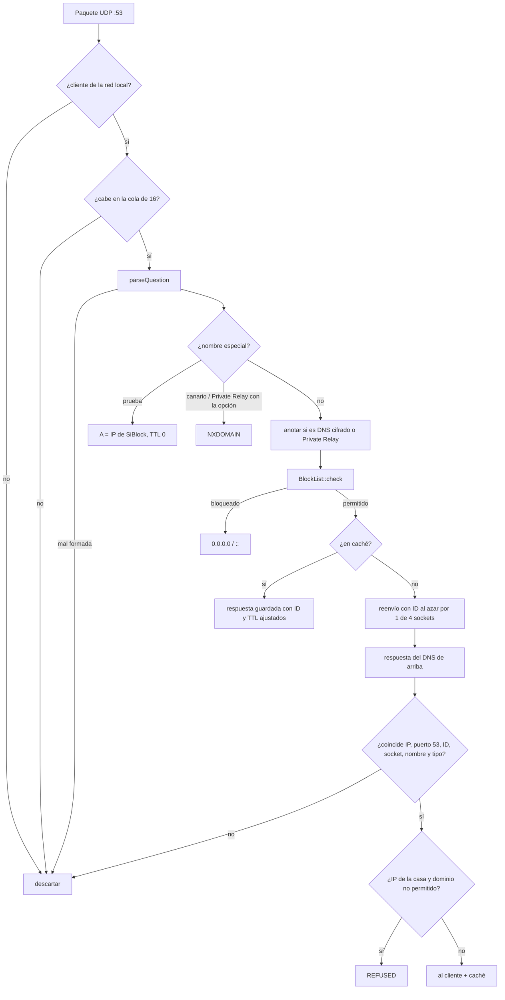

# Camino de una consulta DNS

## 1. Recepción

`DnsServer::onClientPacket` corre en la tarea `async_udp`. Solo hace dos cosas: comprueba que el
cliente esté en la subred del ESP32 (`isLocalClient`) y copia el paquete, de 512 B como máximo, a
la cola. Así el DNS no sirve de resolvedor abierto aunque alguien abra el puerto en el router.

Un paquete de 12 bytes con la firma `adblock-prb!` que viene de la propia IP es la autoprueba
(ver [arquitectura.md](arquitectura.md#vigilancia-en-la-placa)): solo suma a `probesSeen()` y no
cuenta como consulta.

## 2. Parser (`adblock::parseQuestion`)

Exige `QDCOUNT == 1`. Rechaza punteros de compresión en la pregunta y etiquetas de más de 63 B. El
nombre completo no puede pasar de 253 B. Dentro de una etiqueta rechaza `.` y los bytes fuera de
`0x21–0x7e`: así una etiqueta `"bank.com"` no se confunde con `bank.com` en la caché. Pasa todo a
minúsculas. Se prueba con basura y con AddressSanitizer (`test_host`).

## 2b. Nombres especiales *(fase 2)*

Se revisan en `answerLocally`, **después** del portal cautivo y **antes** de la lista. Valen
también durante la pausa. La lógica pura está en `lib/siblock_core/dns_names.*`
(`classifySpecial`, `bypassFlagsFor`) y se prueba en `test_host`. Los nombres ya llegan en
minúsculas y sin punto final.

En este orden:

1. **Nombre de prueba**: `prueba.siblock.internal` o cualquier nombre que termine en
   `.prueba.siblock.internal`. `A` → la IP de SiBlock con TTL 0; `AAAA` y otros tipos → NOERROR
   sin respuestas. No cuenta como bloqueada ni aparece en "últimas consultas". Es lo que usa la
   comprobación "¿este aparato usa SiBlock?" del panel (el nombre lleva 12 caracteres al azar
   delante para que ninguna caché ayude). `.internal` está reservado para redes privadas: nunca
   existe en internet.
2. **Canario de Firefox**: `use-application-dns.net` (exacto, sin subdominios) → **NXDOMAIN
   siempre**. Así Firefox apaga su DNS cifrado automático en esta red. Suma a `canary` en
   `/api/stats`.
3. **iCloud Private Relay**: `mask.icloud.com` y `mask-h2.icloud.com` (exactos) → **NXDOMAIN solo
   si la opción está encendida** (`relay_block` en la NVS; apagada de fábrica). Así Safari deja de
   usar Private Relay en esta red y avisa a la persona. Suma a `relay` en `/api/stats`. Con la
   opción apagada siguen el camino normal.
4. **Detección** (no bloquea): si el nombre es de un DNS cifrado conocido, o es de Private Relay
   con la opción apagada, se anota la IP del aparato en la tabla de "aparatos que se saltan"
   (`siblock::BypassTable`: 16 lugares, solo en RAM, se olvidan a las 24 h, si se llena sale el
   más viejo). Después la consulta sigue a la sección 3
   ([Veredicto, `BlockList::check`](#3-veredicto-blocklistcheck)) como cualquier otra.

Nombres de DNS cifrado que se detectan (`kDohNames`; cuentan el nombre exacto y sus subdominios,
por ejemplo `chrome.cloudflare-dns.com` o `abc123.dns.nextdns.io`, pero no `notdns.google` ni
`cloudflare-dns.com.evil.net`):

| Servicio | Nombres |
|---|---|
| Google | `dns.google` |
| Cloudflare | `cloudflare-dns.com`, `one.one.one.one` |
| Quad9 | `dns.quad9.net`, `dns9.quad9.net`, `dns10.quad9.net`, `dns11.quad9.net` |
| OpenDNS | `doh.opendns.com`, `doh.familyshield.opendns.com` |
| NextDNS | `dns.nextdns.io` |
| AdGuard | `dns.adguard-dns.com`, `dns.adguard.com` |
| CleanBrowsing | `doh.cleanbrowsing.org` |
| Mullvad | `dns.mullvad.net`, `doh.mullvad.net` |

Estos nombres **no se bloquean**: cortarlos es el "modo estricto" que queda para más adelante.
Límite: solo se ve el aparato que le pregunta a SiBlock la dirección de su DNS cifrado. Si el
aparato ya la tiene guardada, usa una IP fija (p. ej. `8.8.8.8` por el puerto 853) o la pregunta
por otro lado, SiBlock no se entera.

### NXDOMAIN (`adblock::buildNxdomain`)

Respuesta "ese nombre no existe": mismo ID y la misma pregunta, QR=1, RA=1, RD copiado de la
consulta, RCODE=3, sin respuestas y sin EDNS (aunque la consulta lo traiga). Sirve igual para `A`,
`AAAA` y cualquier otro tipo. Se usa solo para el canario y para Private Relay; los dominios de la
lista se siguen contestando con `0.0.0.0` / `::`.

## 3. Veredicto (`BlockList::check`)

En este orden, del que más manda al que menos:

1. `ALLOWLIST` de `config.h` → permitido.
2. Regla propia "permitir" (el dominio o un padre) → permitido.
3. Pausa activa → pasa (`kPaused`).
4. Regla propia "bloquear" → bloqueado.
5. Lista descargada: se busca el dominio y cada padre, sin el TLD solo
   (`a.b.ads.com`, `b.ads.com`, `ads.com`) → bloqueado.

Un dominio bloqueado se contesta con `0.0.0.0` para A y `::` para AAAA. Para otros tipos (TXT,
HTTPS…) se contesta NOERROR sin respuestas.

## 4. Caché (`adblock::DnsCache`)

- 64 entradas, de 512 B como máximo cada una. Si se llena, sale la menos usada.
- La clave es nombre + tipo + clase + si trae EDNS. Se guarda el TTL mínimo de la respuesta, con un tope de 1 h.
- Al contestar desde la caché se pone el ID nuevo y se descuenta el TTL.
- No se guarda nada mientras se baja la lista o si el bloque de RAM libre más grande baja de
  24 KB: un `malloc` fallido en esa tarea reiniciaría el ESP32.
- Se vacía al cambiar reglas (así una respuesta con IP de la casa no sobrevive a quitar un
  "permitir") y antes de actualizar la lista (así se liberan ~32 KB).

## 5. Reenvío

- Se asigna un **ID nuevo al azar** (`esp_random`) y se usa uno de **4 sockets** con puertos de
  origen al azar. Quien quiera colar una respuesta falsa tiene que adivinar el ID y el puerto.
- La tabla de consultas en vuelo tiene 64 lugares, con un plazo de 4 s cada una. Si se llena, se
  descarta la consulta y el cliente reintenta.
- Si la respuesta no llega a tiempo cuenta como `timeouts`. Con 3 seguidas se cambia al otro
  DNS (`UPSTREAM_DNS_1` ↔ `UPSTREAM_DNS_2`).
- Una respuesta se acepta solo si coinciden la IP del DNS de arriba, el puerto 53, el ID, el
  socket, el hash del nombre y el tipo.

## 6. Anti-rebinding (`guardRebind`, `REBIND_PROTECTION`)

Si una respuesta de internet trae una A/AAAA privada se contesta **REFUSED** y suma a `rebind`. Son
privadas: 10/8, 172.16/12, 192.168/16, 127/8, 169.254/16, 100.64/10, 0/8,
::1, fe80::/10, fc00::/7 e IPv4 mapeado en IPv6 (`::ffff:a.b.c.d`). Los
dominios en "Permitir" quedan exentos (p. ej. `plex.direct`). Así una página de internet no puede
reapuntar su dominio al panel o al router.

## 7. TCP

`dns_tcp` atiende una conexión a la vez, con 1,5 s de plazo por paso, y reenvía por TCP al DNS de arriba. Si
la respuesta pasa de 4 KB contesta SERVFAIL. Los clientes usan TCP cuando la respuesta UDP vino
truncada (TC=1).

## Estadísticas

`DnsStats` cuenta consultas, bloqueadas, de caché, reenviadas, contestadas, descartadas, sin
respuesta, por TCP y rechazadas por rebind; *(fase 2)* también `canary` y `relay` (NXDOMAIN dados
por el canario y por Private Relay). Aparte hay una tabla de 32 aparatos (sale el menos
reciente) y un anillo con las últimas 20 consultas.

*(Fase 2)* Cada consulta que pasa por el veredicto suma a la **historia de 168 horas**
(`siblock::UsageHistory`, una casilla por hora UTC, consultas y bloqueadas) si la placa ya tiene la
hora de internet; sin hora solo suma a los totales. Cada bloqueada suma al **top de bloqueados**
(`siblock::TopBlocked`, 32 casillas con el método Space-Saving, nombres cortados a 63 bytes; las
cuentas se parten a la mitad cada 24 h). La historia, el top y la tabla de aparatos que se saltan
tienen cada uno su candado (`portMUX`); al leerlos se copian fuera del candado. Ver
[arquitectura.md](arquitectura.md#fase-2-acompañamiento).
