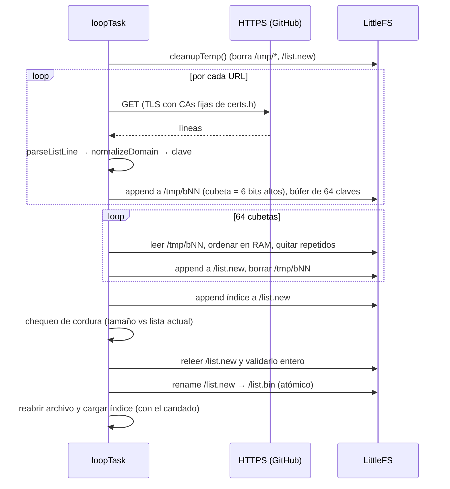

# La lista de bloqueo

## Formato en flash: `/list.bin`

```
┌──────────────────────────────────────────┬────────────────────────────┐
│ n claves de 40 bits, ordenadas (5 B c/u) │ índice: 4097 × uint32 (LE) │
└──────────────────────────────────────────┴────────────────────────────┘
  0                                5·n                          5·n + 16 388
```

- **Clave** = los 40 bits altos del FNV-1a de 64 bits del dominio en minúsculas
  (`adblock::keyOf(hashDomain(...))`). Se guarda en *little-endian* (`packKey`).
- **Índice**: `idx[b]` es la primera posición cuya cubeta (los 12 bits altos de la clave) es
  `>= b`, y `idx[4096] = n`. Al arrancar se lee a RAM (16 KB).
- Se valida al cargar: el tamaño del archivo tiene que ser `5·n + 16 388`, el índice no puede
  bajar y `idx[4096]` tiene que valer `n`. Si algo falla, se descarta y se baja de nuevo.

## Búsqueda (`BlockList::lookupKey`)

1. Con la cubeta se saca el rango `[idx[b], idx[b+1])`: unas 40 claves con 160 k dominios.
2. Se leen de la flash en pedazos de 64 claves y se hace búsqueda binaria en el pedazo que puede
   contenerla.

En la práctica es una sola lectura de ~200 B por cada dominio o padre que se revisa.

Falsos positivos: con 180 k claves de 40 bits la probabilidad de que un dominio cualquiera choque
es ~1,6·10⁻⁷ (~1 en 6 millones). Si pasa, se arregla con "Permitir".

## Actualización (`BlockList::update`)



Detalles:

- **Parser de líneas** (`parseListLine`): acepta `0.0.0.0 dominio`, `127.0.0.1 dominio`, `dominio`
  y `||dominio^`. Ignora comentarios, `localhost` y similares. Las líneas de más de 512 B se cortan.
- **Tope** `MAX_DOMAINS` (180 k, contando repetidos entre listas). Lo que sobra se cuenta en
  `skipped` y el panel lo avisa.
- **Cordura** (`siblock::acceptListSize`, *fase 5*: sacada de `BlockList` sin cambiarla): si la
  lista nueva tiene menos de la mitad de dominios que la actual, se rechaza (suele ser una descarga
  rota). Si el mismo tamaño (±1 %) llega dos veces seguidas, se acepta: quiere decir que quitaste
  una lista a propósito. Si alguna lista llegó **sin `Content-Length`** (no se puede saber si se
  cortó), se pide el 90 % en vez de la mitad. Con una lista actual de 1000 dominios o menos, se
  acepta siempre. *(Fase 5)* Si la persona **cambió las listas elegidas** desde la última
  actualización buena (`lists` ≠ `lists_built` en la NVS), se acepta aunque quede más chica.
- **Antes del `rename`** se relee `/list.new` con la misma validación que al arrancar (un `close()`
  no avisa si la flash se llenó). Si no está entera, se queda la vieja.
- **Si algo falla** (red, TLS, flash llena, cordura), se borra lo temporal, la lista vieja sigue y
  `main.cpp` reintenta a los 1, 5 y 30 min, y después cada 30 min.
- **Formato viejo**: si existen `/list.idx` o `/idx.new` de versiones anteriores, se borran.

## Listas opcionales *(fase 5)*

El catálogo está en `lib/siblock_core/lists.cpp` (antes, `BLOCKLIST_URLS` en `config.h`). Se elige
en el panel; se guarda en la NVS `lists` en bits:

| Bit | Lista | De fábrica | Dirección | Tamaño medido |
|---|---|---|---|---|
| `1` | **General** (siempre): StevenBlack + HaGeZi Light | Encendida | `raw.githubusercontent.com/StevenBlack/hosts/master/hosts` y `raw.githubusercontent.com/hagezi/dns-blocklists/main/wildcard/light-onlydomains.txt` | ~161 000 dominios únicos |
| `2` | **Estafas y tiendas falsas** (no virus): HaGeZi "Fake" (tiendas falsas y estafas) | Apagada | `raw.githubusercontent.com/hagezi/dns-blocklists/main/wildcard/fake-onlydomains.txt` | 10 824 dominios, 190 KB (2026-11-21) |
| `4` | **Algunos anuncios en español** (el panel avisa "por ahora son pocos"): EasyList Spanish | Apagada | `easylist-downloads.adblockplus.org/easylistspanish.txt` | 2 727 líneas, pero solo **23** son `\|\|dominio^` (2026-11-21) |

Todas marcadas **"falta verificar"** en el código (dirección, tamaño y licencia). Lo que se sabe:

- La del plan para estafas (HaGeZi TIF mini) trae ~245 000 dominios: **no cabe** con la general
  en `MAX_DOMAINS` y, como va primero, dejaría fuera casi toda la general. Por eso se usa "Fake".
  "Fake" cubre estafas, **no virus**: falta elegir una lista de malware que quepa. Mientras tanto,
  el panel y la página dicen "estafas y tiendas falsas", sin prometer virus.
- EasyList Spanish es una lista para extensiones del navegador: casi todo son reglas de páginas que
  un DNS no puede usar (`parseListLine` las descarta). Suma muy poco; falta buscar una lista
  regional en formato de dominios (p. ej. de HaGeZi) con fuente.
- Las dos direcciones nuevas salen hoy con certificados que llegan a **ISRG Root X1**, que ya está
  en `certs.h` (revisado con `openssl s_client` el 2026-11-21). Falta verificar en la placa.

**Orden de descarga: estafas → español → general.** El tope (`MAX_DOMAINS`, 180 000) se llena en
ese orden y cuenta los repetidos entre listas: si no cabe todo, lo que se queda fuera es el final de
la general (anuncios), nunca estafas ni la lista en español (que es muy chica). Con estafas prendida
pasa: general (~78k + ~93k contando repetidos) más estafas (~10,8k) suman ~182k, unos 2k más que el
tope (estimado con las medidas del 2026-11-21; falta verificar en la placa). El panel lo avisa
con `skipped` ("No cupieron N dominios de anuncios; las estafas sí están todas"). En la serie se ve
`[lista] 1/4 …` hasta `4/4` con las tres listas. Una máscara inválida en la NVS (par, 0 o mayor que
7) se porta como `1`. Una lista sin dirección en el catálogo no se ofrece ni se baja
(`listsOffered`).

Al cambiar la selección se baja todo otra vez; mientras tanto sigue la lista vieja.

## Reglas propias: `/custom.txt`

Hay una regla por línea: `+dominio` bloquea y `-dominio` permite. Caben hasta 200. Se guardan
escribiendo `/custom.new` y renombrándolo, igual que la lista. En RAM viven en dos vectores
ordenados (`adblock::CustomRules`). "Permitir" gana sobre la lista. *(Fase 5)* Un **horario**
activo gana sobre "Permitir" (ver [api.md](api.md#aparatos-fase-5)). El respaldo cambia todas las
reglas de una vez (`replaceRules`, todo o nada, mismo guardado atómico).
