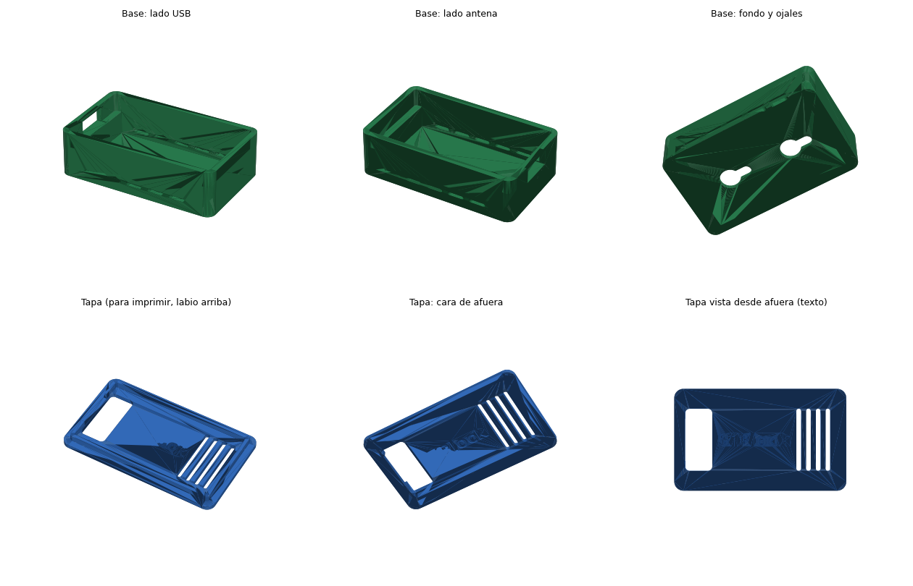

# Caja imprimible de SiBlock

Caja para un **ESP32 DevKit de 30 pines (WROOM-32)**. Mide 56.5 × 33.5 × 23.6 mm por fuera.



| Archivo | Para qué |
|---|---|
| `base.stl`, `tapa.stl` | Listos para imprimir, ya en la posición correcta |
| `caja_siblock.step` | Para abrir en otro programa de CAD |
| `caja_siblock.FCStd` | El modelo de FreeCAD |
| `caja_siblock.py` | El script que genera todo; las medidas están al inicio |

## Qué tiene

- Hueco para el cable USB en un lado corto.
- Una ventana en la tapa sobre el extremo del USB, para ver el LED y apretar el botón BOOT con
  un palillo.
- Ventilación abajo en los lados largos y una rejilla en la tapa sobre la antena.
- Repisas en los lados cortos: la placa se apoya ahí y los pines quedan colgando sin tocar nada.
- Dos ojales en el fondo para colgarla en la pared con tornillos de 3 a 3.5 mm.
- "SiBlock" grabado en la tapa.
- La tapa entra a presión, con 0.2 mm de juego.

## Cómo imprimirla

- PLA o PETG, capas de 0.2 mm, 3 perímetros, 15 % de relleno. No lleva soportes.
- La base se imprime con el fondo sobre la cama. La tapa, con el texto sobre la cama y el labio
  hacia arriba (así vienen los STL).
- Si la tapa queda muy dura o muy floja, cambia `JUEGO_TAPA` en el script (0.15 más apretada,
  0.3 más suelta).

## Si tu placa es otra

Las medidas son las del DevKit V1 de 30 pines (51.5 × 28.5 mm). Mide tu placa y cambia `PCB_L` y
`PCB_W` al inicio de `caja_siblock.py`; la DevKitC de 38 pines, por ejemplo, mide 54.4 × 27.9.
Después vuelve a generar los archivos con FreeCAD 1.x:

```sh
freecadcmd caja_siblock.py
```

El script se detiene si la placa (con su módulo, el USB y los pines) chocaría con la base o la
tapa, o si alguna pieza no queda cerrada para imprimir.

**Falta probarla con una placa real:** las medidas salen de la hoja de datos, no de una placa
medida.
